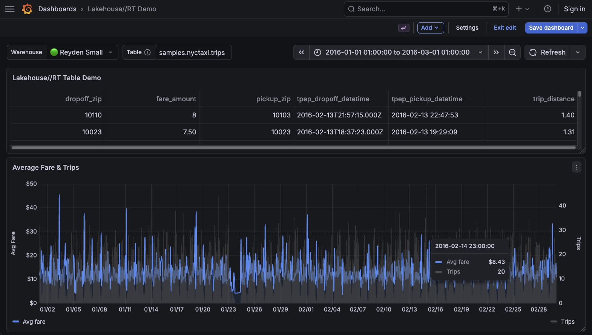

# Grafana Lakehouse//RT Quickstart

This is a starter project that shows how to query Databricks SQL warehouses, including Lakehouse//RT, from Grafana. It includes a prebuilt dashboard that queries the warehouse directly with the [Infinity](https://grafana.com/grafana/plugins/yesoreyeram-infinity-datasource/) plugin.



## What's included

| Path | Contents |
|---|---|
| `docker-compose.yml` | Grafana 12.4 with the Infinity plugin and anonymous admin access |
| `grafana/provisioning/datasources/infinity.yml` | Infinity data source `databricks-lakehouse-rt`, pointed at your workspace |
| `grafana/provisioning/dashboards/lakehouse-rt-demo.json` | **Lakehouse//RT Demo** dashboard: reads the taxi sample data and shows it as a table and a time series chart |

The dashboard has three variables:

| Variable | Purpose |
|---|---|
| **Warehouse** | Dropdown of the workspace's SQL warehouses |
| **Table** | Fully qualified name of the taxi trips table. Default `main.default.taxi_trips` |
| `databricks_rows_parser` (hidden) | JSONata expression used as the root selector by every panel to parse the results |

## Installation / Prerequisites

- Docker and Docker Compose (for the best experience with no local dependencies)
- A Databricks workspace with a `Lakehouse//RT` warehouse
- A personal access token with `sql` permission. OAuth2 also works; see Infinity's [authentication settings](https://grafana.com/docs/plugins/yesoreyeram-infinity-datasource/latest/setup/configuration/).

### 1. Create the demo table

The dashboard uses a copy of the NYC taxi sample data from `samples.nyctaxi.trips`: about 22,000 trips from January and February 2016. Create the copy on a regular SQL warehouse or in a notebook:

```sql
CREATE TABLE main.default.taxi_trips AS SELECT * FROM samples.nyctaxi.trips;
```

To use a different catalog or schema, see [Using a different table](#using-a-different-table).

> **Note:** for now, Lakehouse//RT warehouses can't read Delta Sharing tables. If your data comes from a share, copy it into a regular table first, as above.

### 2. Configure environment

```bash
cp .env.example .env
```

Edit `.env`:

| Variable | Description |
|---|---|
| `DATABRICKS_HOST` | Your workspace URL, e.g. `https://my-workspace.cloud.databricks.com` |
| `DATABRICKS_TOKEN` | Personal access token. Grafana sends it as a Bearer token |

### 3. Start Grafana

```bash
docker compose up
```

Open http://localhost:3000. There's no login, because anonymous admin access is enabled. Go to **Dashboards → Lakehouse//RT Demo** and pick a warehouse from **Warehouse**. Running warehouses are marked 🟢.

### Stopping

```bash
docker compose down
```

To also remove Grafana's data volume:

```bash
docker compose down -v
```

### Using a different table

Type the table name into the **Table** box at the top of the dashboard, or add `?var-table=my_catalog.my_schema.taxi_trips` to the dashboard URL. 

The panels expect the `samples.nyctaxi.trips` columns: `tpep_pickup_datetime`, `fare_amount` and so on. You can of course modify the queries in the panels themselves to use your own tables.

### Using an existing Grafana instance

1. Install the **Infinity** plugin.
2. Add the data source in one of two ways:
   - Copy `infinity.yml` into Grafana's `provisioning/datasources` directory, and set `DATABRICKS_HOST` and `DATABRICKS_TOKEN` in Grafana's environment.
   - Or create an Infinity data source in **Connections → Data sources**:
     - **URL** and **Allowed hosts:** your workspace URL
     - **Auth:** Bearer token, with your token as the value

3. (Optionally) Import `lakehouse-rt-demo.json` with **Dashboards → New → Import**. If you created the data source in the UI, it has a different uid than `databricks-lakehouse-rt`, so select your data source in each panel after importing.

### Adding panels

Configure the Infinity query like this:

| Setting | Value |
|---|---|
| Type | JSON |
| Parser | JSONata |
| Source | URL |
| Format | Table |
| Method | POST |
| URL | `/api/2.0/sql/statements` |
| Body type | Raw, content type `application/json` |
| Root selector | `${databricks_rows_parser}` |


`${databricks_rows_parser}` is a hidden variable in the demo dashboard. On another dashboard, add it under **Dashboard settings → Variables → New variable**: type **Constant**, name `databricks_rows_parser`, with the expression below as its value. Or paste the expression straight into **Root selector**. The row selector is used to convert Statement Execution API responses in a format Grafana can use. You can also specify it inline as part of the panel's **Root selector**.

```jsonata
(
  $num  := ["BYTE","SHORT","INT","LONG","FLOAT","DOUBLE","DECIMAL"];
  $cols := manifest.schema.columns;
  [$map(result.data_array, function($row) {
    $merge($map($cols, function($c, $i) {(
      $v := $row[$i];
      { $c.name:
          ($v and $c.type_name in $num)      ? $number($v) :
          ($v and $c.type_name = "BOOLEAN")  ? $v = "true" :
          $v }
    )}))
  })]
)
```

The body below also uses the dashboard's `${warehouse_id}` and `${table}` variables. On another dashboard, replace them with your warehouse ID and table name.

Body:

```json
{
  "warehouse_id": "${warehouse_id}",
  "statement": "SELECT ... FROM ${table} WHERE <timestamp_column> >= timestamp_millis(${__from}) AND <timestamp_column> < timestamp_millis(${__to})",
  "disposition": "INLINE",
  "format": "JSON_ARRAY",
  "wait_timeout": "50s"
}
```

Things to know:

- **Timestamps arrive as text.** Numeric columns come back as numbers, but timestamp columns need a **Convert field type → Time** transformation before time series panels can use them.
- **Time macros:** `${__from}` and `${__to}` are the dashboard time range in epoch milliseconds. `${__interval_ms}` is the bucket size Grafana picks for the panel width and the chart uses it for grouping.
- **Keep results small.** Inline results are limited to 25 MiB, and Infinity reads only the first chunk of the result. Aggregate in SQL rather than pulling raw rows.

### Troubleshooting

| Symptom | Likely cause |
|---|---|
| Chart shows "No data" | Time range doesn't cover January–February 2016 |
| Query fails with "table or view not found" | **Table** doesn't point at your copy of the data |
| **Warehouse** dropdown is empty | The token can't list warehouses |

## How to get help

Databricks support doesn't cover this content. For questions or bugs, please open a GitHub issue and the team will help on a best effort basis.

## License

&copy; 2025 Databricks, Inc. All rights reserved. The source in this notebook is provided subject to the Databricks License [https://databricks.com/db-license-source].  All included or referenced third party libraries are subject to the licenses set forth below.

| library                                | description             | license    | source                                              |
|----------------------------------------|-------------------------|------------|-----------------------------------------------------|
